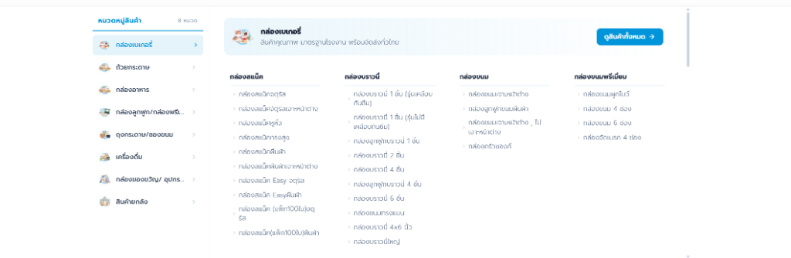
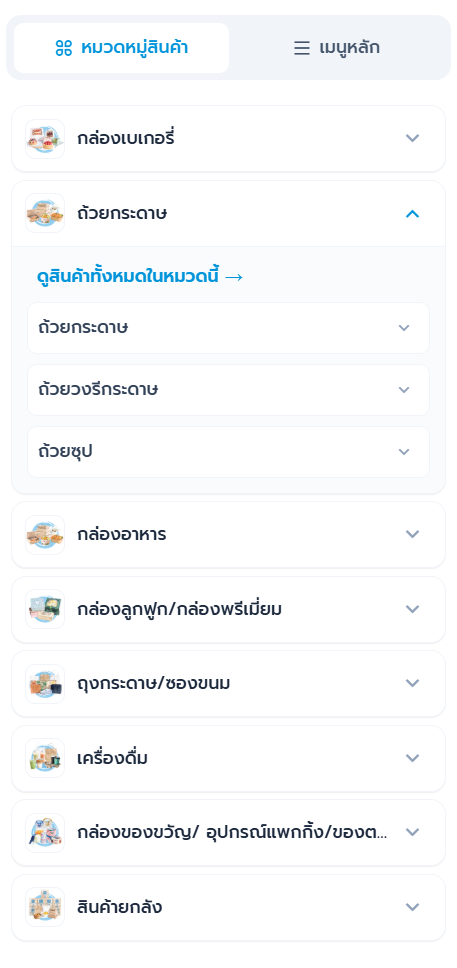
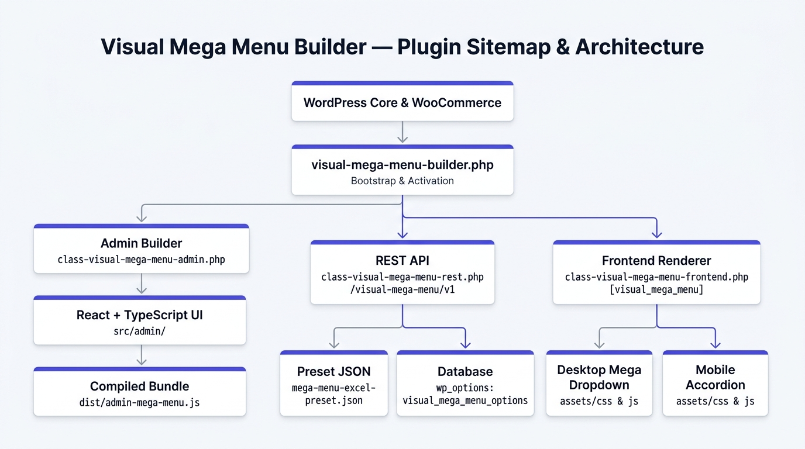
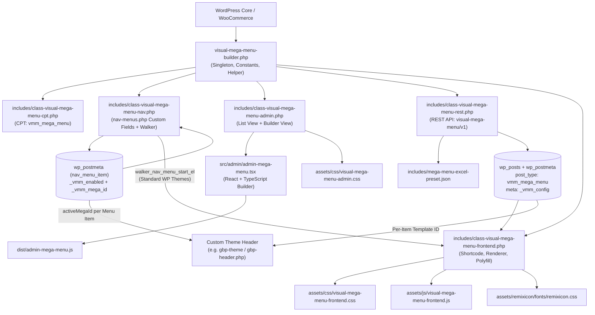
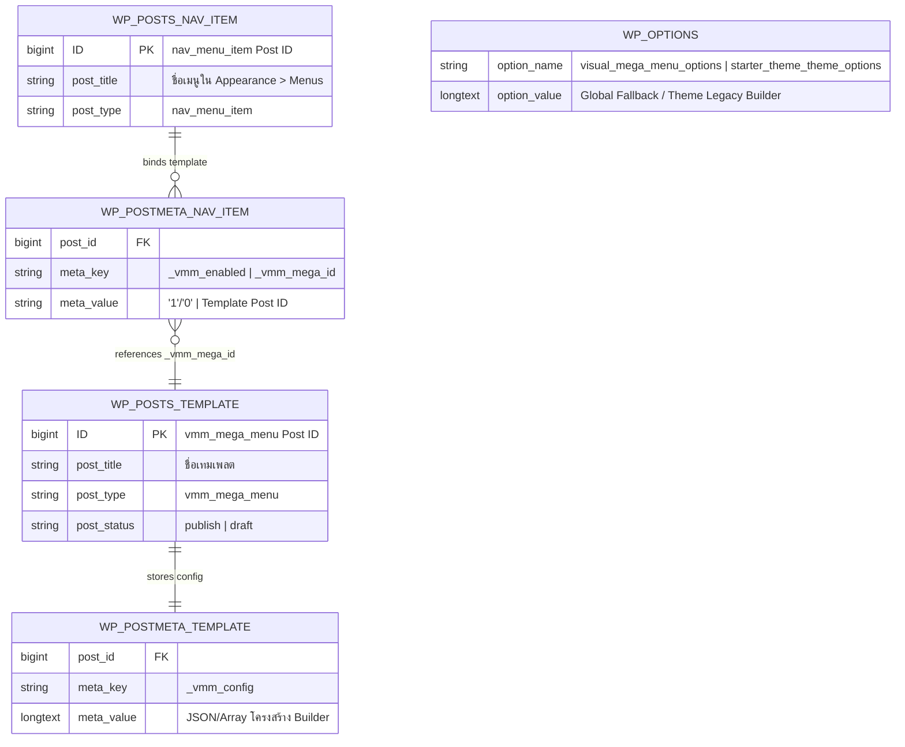

<div align="center">

# Visual Mega Menu Builder

**ปลั๊กอิน WordPress สำหรับสร้าง จัดการ และแสดงผล Mega Menu สำหรับ WooCommerce พร้อมหน้าจัดการหลังบ้านแบบ Visual Drag & Drop Builder (React + TypeScript)**
ผมเอามาใช้จริงแล้วก็ปรับไปใช้ กับงานอยู่ๆเรื่อยๆ จึงเกิดเป็น ปลั๊กอินนี้ขึ้นมา แชร์ให้เพื่อนนำไปใช้หรือพัฒนาต่อ ซึ่งปกติ ปลั๊กอิน mega menu จะเป็น builder ใช้งานยากๆ ผมออกแบบให้มันง่ายขึ้นแล้วสามารถกดเปิดใช้ได้ใน list menu ในหน้า wp-nav ได้เลย หรือนำไป custom ก็ง่ายนะ ตัวปลั๊กอินไม่ซับซ้อน


</div>

---

## จุดเด่น (Features)

- **Mega Menu Templates (List View + Builder View)**: จัดการเทมเพลต Mega Menu ได้หลายชุดผ่านตารางรายการ (**All Templates** + **Add New Mega Menu**) เก็บข้อมูลแยกเป็น Custom Post Type (`vmm_mega_menu`)
- **WordPress Nav Menus Integration (`nav-menus.php`)**: เชื่อมต่อผ่าน Hook มาตรฐาน `wp_nav_menu_item_custom_fields` สามารถเปิด/ปิด Mega Menu และเลือก Template ให้แต่ละ Menu Item ในหน้า **Appearance > Menus** ได้โดยตรง
- **Visual Drag & Drop Builder**: จัดโครงสร้างเมนูได้สูงสุด 3–4 ระดับ (Level 1 แท็บหลัก -> Level 2 คอลัมน์ -> Level 3–4 ลิงก์ย่อย) พร้อม Live Preview
- **WooCommerce Integration**: ซิงก์หมวดหมู่และสินค้าจาก WooCommerce อัตโนมัติ, ค้นหาหน้า/หมวดหมู่/สินค้าผ่าน Content Picker และตรวจจับ/แก้ไข Parent Loop
- **Excel Preset & JSON Import/Export**: รองรับการนำเข้า-ส่งออกโครงสร้างเมนูเป็น JSON (รองรับทั้ง key `visual_mega_menu_builder` และ `gbp_mega_menu_builder` จากธีม) และรีเซ็ตกลับไปใช้ Preset เริ่มต้นได้ทันที
- **Responsive Dual-View**: แสดงผลแบบ **Mega Dropdown** บน Desktop และ **Accordion Tree** บน Mobile (`<= 1024px`)
- **Shortcode & PHP Helper**: เรียกใช้งานได้ทั้ง `[visual_mega_menu]` และ `visual_render_mega_menu()`

---

## ตัวอย่างหน้าจอการใช้งาน (UI Preview)

### 1. Admin Visual Drag & Drop Builder
<p align="center">
  
  <br />
  <sub>หน้าจัดการหลังบ้าน React + TypeScript: จัดโครงสร้างเมนู, คอลัมน์, Content Picker และ Live Preview แบบเรียลไทม์</sub>
</p>

### 2. Frontend Responsive Views (Desktop & Mobile)

<table>
  <thead>
    <tr>
      <th width="70%">Desktop — Mega Dropdown View</th>
      <th width="30%">Mobile — Accordion Tree View</th>
    </tr>
  </thead>
  <tbody>
    <tr>
      <td align="center" valign="middle">
        
      </td>
      <td align="center" valign="middle">
        
      </td>
    </tr>
    <tr>
      <td align="center"><sub>แสดงผลแบบ Sidebar Tabs คู่กับ Multi-Column Mega Menu</sub></td>
      <td align="center"><sub>แสดงผลแบบสลับแท็บและ Accordion บนหน้าจอมือถือ</sub></td>
    </tr>
  </tbody>
</table>

---

## Sitemap & Architecture (แผนผังระบบและโครงสร้างไฟล์)

<p align="center">
  
  <br />
  <sub>แผนผังสถาปัตยกรรม การเชื่อมโยงฐานข้อมูล และการแสดงผลทั้งฝั่ง Admin และ Frontend</sub>
</p>

<details>
<summary>ดูแผนผังสถาปัตยกรรมแบบ Mermaid Diagram (Interactive Code)</summary>



</details>

### โครงสร้างโฟลเดอร์ (Directory Sitemap)

```text
visual-mega-menu-builder/
├── visual-mega-menu-builder.php            # Bootstrap หลัก, ค่าคงที่, Activation Hook และ visual_render_mega_menu()
├── package.json                            # สคริปต์ build/watch สำหรับ @wordpress/scripts
├── README.md                               # เอกสารคู่มือ Sitemap และโครงสร้างฐานข้อมูล
├── includes/
│   ├── class-visual-mega-menu-cpt.php      # ลงทะเบียน CPT `vmm_mega_menu` และจัดการเมตา `_vmm_config`
│   ├── class-visual-mega-menu-nav.php      # Hook `wp_nav_menu_item_custom_fields`, `walker_nav_menu_start_el` และบันทึก `_vmm_enabled` / `_vmm_mega_id`
│   ├── class-visual-mega-menu-admin.php    # เมนูหลัก Visual Mega Menu (หน้า List View ตารางเทมเพลต + หน้า Builder View)
│   ├── class-visual-mega-menu-rest.php     # REST API (สร้าง/แก้ไข Template, GET/POST options, mega-builder-data, reset-preset)
│   ├── class-visual-mega-menu-frontend.php # Shortcode [visual_mega_menu], ตัวเรนเดอร์ Desktop/Mobile และ Polyfill
│   └── mega-menu-excel-preset.json         # ข้อมูล Preset เริ่มต้นสำหรับสร้างเมนูครั้งแรกหรือรีเซ็ต
├── src/admin/                              # ซอร์สโค้ด React + TypeScript (Admin Builder)
│   ├── admin-mega-menu.tsx                 # Entry point เมานต์เข้า #visual-mega-menu-builder-root
│   ├── MegaMenuSettings.tsx                # คอนโทรลเลอร์หลัก, Ordered Product Categories, Import/Export JSON, Save/Reset
│   ├── MenuStructure.tsx                   # จัดการรายการเมนูหลัก (Level 1)
│   ├── MegaMenuColumnBuilder.tsx           # จัดการคอลัมน์และลิงก์ย่อย (Level 2–4)
│   ├── MenuItemSettings.tsx                # ตั้งค่าการแสดงผลรายเมนู (ไอคอน, คอลัมน์, ความกว้าง, Hover)
│   ├── ContentPicker.tsx                   # ตัวเลือก Pages / Categories / Products จาก WordPress/WooCommerce
│   ├── LivePreview.tsx                     # พรีวิวผลลัพธ์แบบเรียลไทม์ในหน้า Admin
│   └── types.ts                            # TypeScript Interfaces ของระบบ Builder
├── dist/                                   # ไฟล์คอมไพล์สำหรับหน้า Admin (สร้างจาก npm run build)
│   ├── admin-mega-menu.js
│   └── admin-mega-menu.asset.php
└── assets/
    ├── images/
    │   ├── preview-admin-builder.jpg       # ภาพตัวอย่างหน้า Admin Visual Builder
    │   ├── preview-desktop.png             # ภาพตัวอย่างหน้าบ้าน Desktop Mega Dropdown
    │   ├── preview-mobile.png              # ภาพตัวอย่างหน้าบ้าน Mobile Accordion
    │   └── sitemap.jpg                     # รูปแผนผัง Sitemap & Architecture ของปลั๊กอิน
    ├── css/
    │   ├── visual-mega-menu-admin.css      # สไตล์หน้า Admin Builder
    │   └── visual-mega-menu-frontend.css   # สไตล์หน้าบ้าน (Desktop Tabs + Mobile Accordion)
    ├── js/
    │   └── visual-mega-menu-frontend.js    # สคริปต์สลับแท็บ (Hover/Click) และเปิด-ปิด Accordion บนมือถือ
    └── remixicon/                          # ชุดไอคอน Remix Icon (CSS + Webfonts)
```

---

## โครงสร้างฐานข้อมูล (Database & Meta Schema)

### 1. ความสัมพันธ์ของข้อมูล (ER Diagram)



### 2. ตารางสรุป Storage & Meta Keys

| Entity | Storage | Meta Keys / Columns | หน้าที่ |
| :--- | :--- | :--- | :--- |
| **Mega Menu Template** | `wp_posts` (`post_type = vmm_mega_menu`) | `ID`, `post_title`, `post_status`, meta `_vmm_config` | เก็บชื่อเทมเพลตและโครงสร้าง Builder (`visual_mega_menu_builder` + `visual_mega_menu_items`) |
| **Nav Menu Item Binding** | `wp_postmeta` (บน `nav_menu_item`) | `_vmm_enabled` (`'1'`/`'0'`), `_vmm_mega_id` (`int`) | เก็บสถานะเปิด/ปิด Mega Menu และ `post_id` ของเทมเพลตที่เลือกจากหน้า `Appearance > Menus` |
| **Global Fallback Option** | `wp_options` | `visual_mega_menu_options` | ค่าเริ่มต้น/Fallback กรณีเรียกใช้งานผ่าน Shortcode หรือยังไม่ได้เลือกเทมเพลตเฉพาะ |
| **Theme Legacy Fallback** | `wp_options` | `starter_theme_theme_options['gbp_mega_menu_builder']` | Fallback อัตโนมัติเมื่อยังไม่มีข้อมูลใน `visual_mega_menu_options` หรือ Post Meta |

### 3. ตัวอย่างโครงสร้าง JSON ภายใน `_vmm_config`

```json
{
  "visual_mega_menu_builder": {
    "menuItems": [
      {
        "id": "tab-1",
        "label": "เซ็ทปิ่นโต",
        "url": "https://example.com/product-category/bento-set/",
        "termId": 123,
        "enableMegaMenu": true,
        "columnsCount": 4,
        "dropdownWidth": "container",
        "iconClass": "ri-box-3-line",
        "columns": [
          {
            "id": "col-1",
            "heading": "ปิ่นโตกระดาษ",
            "url": "...",
            "termId": 124,
            "items": [
              { "id": "lnk-1", "label": "รุ่น 2 ชั้น", "url": "...", "openInNewTab": false }
            ]
          }
        ]
      }
    ],
    "visibilitySettings": {
      "showIcons": true,
      "hoverToOpen": true,
      "mobileAccordion": true
    }
  },
  "visual_mega_menu_items": [
    { "term_id": 123, "enabled": true, "custom_label": "เซ็ทปิ่นโต" }
  ]
}
```

---

## การใช้งาน (Usage & Integration)

### 1. สร้างและจัดการ Mega Menu Templates (WP Admin)
1. ไปที่เมนู **Visual Mega Menu** (`wp-admin/admin.php?page=visual-mega-menu-builder`) จะพบหน้า **List View** แสดงรายการ Templates ทั้งหมด พร้อมคอลัมน์สถานะและจำนวนเมนูที่ผูกไว้
2. กดปุ่ม **Add New Mega Menu** (หรือกด **Open Builder** บนรายการเดิม) เพื่อเปิดหน้า Drag & Drop Builder
3. ตั้งชื่อเทมเพลตในช่อง **Template Name**, จัดวางแท็บ/คอลัมน์ หรือจัดลำดับหมวดหมู่ใน **Ordered Product Categories** (แสดงชื่อหมวดหมู่ WooCommerce จริงให้อัตโนมัติ), แล้วกด **Save changes**

### 2. Import / Export JSON (ใช้งานร่วมกับธีมได้)
- ในหน้า Builder สามารถกด **Export JSON** เพื่อสำรองข้อมูลโครงสร้างเมนู หรือกด **Import JSON** เพื่อนำเข้าไฟล์จากเทมเพลตอื่นได้ทันที
- รองรับทั้งไฟล์จาก `visual-mega-menu-builder` และไฟล์ JSON ที่ Export มาจาก Theme Options (`gbp_mega_menu_builder`)

### 3. ผูกเทมเพลตกับเมนูใน WordPress (`nav-menus.php`)
1. ไปที่ **Appearance > Menus** (`wp-admin/nav-menus.php`) แล้วเลือกเมนูหลักของเว็บไซต์
2. เปิดกล่องรายการเมนูที่ต้องการ (เช่น `สินค้า` หรือ `งานสั่งผลิตพิมพ์โลโก้`) -> ติ๊ก **เปิดใช้ Mega Menu** และเลือกเทมเพลตเฉพาะของเมนูนั้นจาก Dropdown **เลือกเมก้าเมนู**
3. สามารถผูก **หลาย Menu Item กับคนละ Template** ได้พร้อมกัน เช่น `สินค้า` ใช้เทมเพลตหมวดสินค้า ส่วน `งานสั่งผลิตพิมพ์โลโก้` ใช้เทมเพลตบริการสั่งผลิต
4. กด **Save Menu** เพื่อบันทึกลง Post Meta (`_vmm_enabled`, `_vmm_mega_id`) ของ Menu Item นั้น

### 4. การแสดงผลบน Frontend (Desktop & Mobile)
- **ธีม WordPress ทั่วไปที่ใช้ `wp_nav_menu()`**: ปลั๊กอินจะแทรก Panel ผ่าน Hook `walker_nav_menu_start_el` ให้อัตโนมัติ โดย Desktop แสดงเป็น Mega Dropdown และ Mobile (`<= 1024px`) แสดงเป็น `#visual-mega-mobile-view` (Accordion)
- **ธีม Custom Header (เช่น `gbp-theme` / `gbp-header.php`)**:
  - **Desktop**: แยก State ด้วย `activeMegaId` ตามแต่ละ Menu Item ทำให้แสดงข้อมูลตรงตาม Template ที่ผูกไว้และขึ้นสี Active เฉพาะเมนูที่เปิดอยู่
  - **Mobile Drawer**: เมนูหลัก (`สินค้า`) กดสลับไปแท็บ `หมวดหมู่สินค้า` ส่วนเมนูอื่นที่มี Mega Menu ของตัวเองจะกางรายการหมวดย่อยตาม Template นั้นๆ เป็น Accordion ภายในแท็บ `เมนูหลัก`

### 5. Shortcode & PHP Template Helper
วาง Shortcode ในหน้าเพจ, โพสต์, หรือ Widget:

```text
[visual_mega_menu]
```

รองรับพารามิเตอร์:
- `layout`: `both` (ค่าเริ่มต้น) | `desktop` | `mobile`
- `active_tab`: key ของแท็บที่ต้องการเปิดเป็นค่าเริ่มต้น

หรือเรียกใช้ในไฟล์ธีม (เช่น `header.php`):

```php
if ( function_exists( 'visual_render_mega_menu' ) ) {
    visual_render_mega_menu( array(
        'layout' => 'both',
    ) );
}
```

---

## REST API Endpoints (`visual-mega-menu/v1`)

ทุก Endpoint ต้องใช้สิทธิ์ `manage_options` และส่ง WordPress REST Nonce:

| Method | Endpoint | หน้าที่ |
| :--- | :--- | :--- |
| `GET` | `/wp-json/visual-mega-menu/v1/options` | ดึงโครงสร้างเมนู (ส่ง `?post_id={ID}` เพื่อดึงจากเทมเพลต CPT `vmm_mega_menu` หรือไม่ส่งเพื่อดึง Global Option) |
| `POST` | `/wp-json/visual-mega-menu/v1/options` | บันทึกโครงสร้างเมนู (รองรับ `is_template`, `post_id`, `title` สำหรับสร้าง/อัปเดตเทมเพลต CPT `vmm_mega_menu`) |
| `GET` | `/wp-json/visual-mega-menu/v1/mega-builder-data` | ดึงรายการ Pages, WooCommerce Categories, Products และ Preset |
| `GET` | `/wp-json/visual-mega-menu/v1/mega-categories` | ดึงหมวดหมู่สินค้า WooCommerce |
| `POST` | `/wp-json/visual-mega-menu/v1/reset-preset` | รีเซ็ตเมนูกลับไปใช้ค่าจาก `mega-menu-excel-preset.json` |

> **หมายเหตุการเข้ากันได้ (Compatibility Notes):**
> - ระบบ Sanitize ใน REST API คงรูปแบบคีย์ `camelCase` (`megaMenu`, `subTabs`, `subTabItems`, `categoryCards`, `orderedCategoryIds`, `topPromo`, `brandStrip`) ไว้ครบถ้วน
> - Frontend รองรับการ Fallback อ่านข้อมูลจาก Option `gbp_mega_menu_builder` อัตโนมัติ เมื่อยังไม่มีข้อมูลใน Option `visual_mega_menu_builder` หรือ Post Meta ของเทมเพลต

---

## การพัฒนาและคอมไพล์ (Development)

```bash
npm install
npm run watch   # คอมไพล์แบบเฝ้าดูการเปลี่ยนแปลง (Development)
npm run build   # คอมไพล์ไฟล์ Production ลงใน dist/
```

---

## โครงสร้าง Git Branch (Git Workflow)

Repository นี้ใช้ 2 Branch หลักควบคู่กัน:
- `main`: โค้ดสำหรับใช้งานจริง (Production / Stable)
- `dev`: โค้ดสำหรับการพัฒนาและทดสอบฟีเจอร์ใหม่ (Development)

```bash
git checkout dev
git merge main
git push origin dev
git checkout main
```

---

## ผู้จัดทำ (Author)

- **Akegapol Pinyopun**
- GitHub: [https://github.com/apkgap](https://github.com/apkgap)
- Repository: [https://github.com/apkgap/visual-mega-menu-builder](https://github.com/apkgap/visual-mega-menu-builder)
