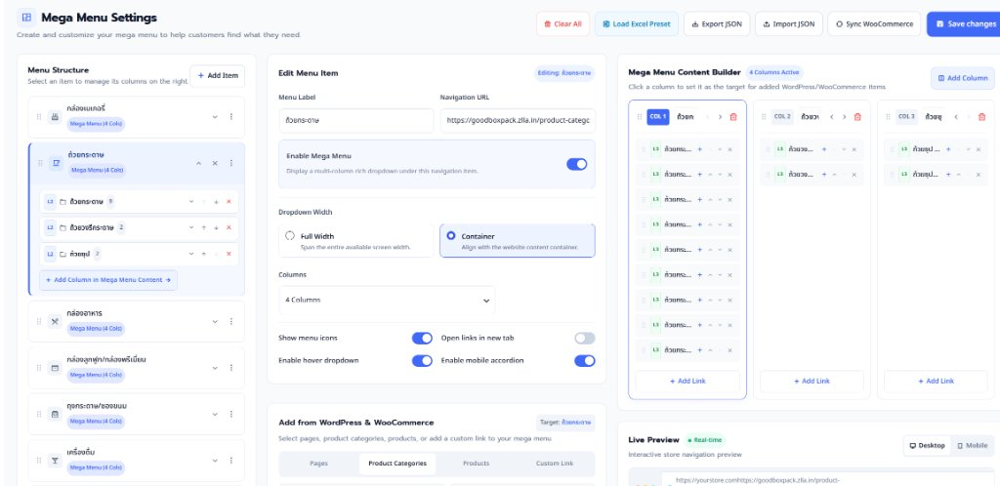
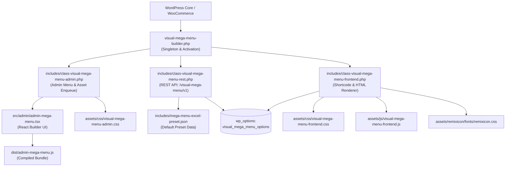

<div align="center">

# Visual Mega Menu Builder

**ปลั๊กอิน WordPress สำหรับสร้าง จัดการ และแสดงผล Mega Menu สำหรับ WooCommerce พร้อมหน้าจัดการหลังบ้านแบบ Visual Drag & Drop Builder (React + TypeScript)**


</div>

---

## จุดเด่น (Features)

- **Visual Drag & Drop Builder**: จัดโครงสร้างเมนูได้สูงสุด 3–4 ระดับ (Level 1 แท็บหลัก → Level 2 คอลัมน์ → Level 3–4 ลิงก์ย่อย) พร้อม Live Preview
- **WooCommerce Integration**: ซิงก์หมวดหมู่และสินค้าจาก WooCommerce อัตโนมัติ, ค้นหาหน้า/หมวดหมู่/สินค้าผ่าน Content Picker และตรวจจับ/แก้ไข Parent Loop
- **Excel Preset & JSON Import/Export**: รองรับการนำเข้า-ส่งออกโครงสร้างเมนูเป็น JSON และรีเซ็ตกลับไปใช้ Preset เริ่มต้นได้ทันที
- **Responsive Dual-View**: แสดงผลแบบ **Mega Dropdown** บน Desktop และ **Accordion Tree** บน Mobile (`<= 1024px`)
- **Shortcode & PHP Helper**: เรียกใช้งานได้ทั้ง `[visual_mega_menu]` และ `visual_render_mega_menu()`

---

## ตัวอย่างหน้าจอการใช้งาน (UI Preview)

### 1. Admin Visual Drag & Drop Builder
<p align="center">
  
  <br />
  <sub>หน้าจัดการหลังบ้าน React + TypeScript: จัดโครงสร้างเมนู, คอลัมน์, Content Picker และ Live Preview แบบเรียลไทม์</sub>
</p>

### 2. Frontend Responsive Views (Desktop & Mobile)

<table>
  <thead>
    <tr>
      <th width="70%">Desktop — Mega Dropdown View</th>
      <th width="30%">Mobile — Accordion Tree View</th>
    </tr>
  </thead>
  <tbody>
    <tr>
      <td align="center" valign="middle">
        
      </td>
      <td align="center" valign="middle">
        
      </td>
    </tr>
    <tr>
      <td align="center"><sub>แสดงผลแบบ Sidebar Tabs คู่กับ Multi-Column Mega Menu</sub></td>
      <td align="center"><sub>แสดงผลแบบสลับแท็บและ Accordion บนหน้าจอมือถือ</sub></td>
    </tr>
  </tbody>
</table>

---

## Sitemap & Architecture (แผนผังระบบและโครงสร้างไฟล์)

<p align="center">
  
  <br />
  <sub>แผนผังสถาปัตยกรรมและโครงสร้างการทำงานของปลั๊กอิน Visual Mega Menu Builder</sub>
</p>

<details>
<summary>ดูแผนผังแบบ Mermaid Diagram (Interactive Code)</summary>



</details>

### โครงสร้างโฟลเดอร์ (Directory Sitemap)

```text
visual-mega-menu-builder/
├── visual-mega-menu-builder.php            # Bootstrap หลัก, ค่าคงที่, Activation Hook และ Helper Function
├── package.json                            # สคริปต์ build/watch สำหรับ @wordpress/scripts
├── README.md                               # เอกสารคู่มือและ Sitemap ของปลั๊กอิน
├── includes/
│   ├── class-visual-mega-menu-admin.php    # ลงทะเบียนเมนูหลังบ้าน (Visual Mega Menu) และโหลด Assets
│   ├── class-visual-mega-menu-rest.php     # REST API (GET/POST options, mega-builder-data, mega-categories, reset-preset)
│   ├── class-visual-mega-menu-frontend.php # Shortcode [visual_mega_menu], ตัวเรนเดอร์ Desktop/Mobile และ Polyfill
│   └── mega-menu-excel-preset.json         # ข้อมูล Preset เริ่มต้นสำหรับสร้างเมนูครั้งแรกหรือรีเซ็ต
├── src/admin/                              # ซอร์สโค้ด React + TypeScript (Admin Builder)
│   ├── admin-mega-menu.tsx                 # Entry point เมานต์เข้า #visual-mega-menu-builder-root
│   ├── MegaMenuSettings.tsx                # คอนโทรลเลอร์หลัก, Import/Export JSON, Save/Reset
│   ├── MenuStructure.tsx                   # จัดการรายการเมนูหลัก (Level 1)
│   ├── MegaMenuColumnBuilder.tsx           # จัดการคอลัมน์และลิงก์ย่อย (Level 2–4)
│   ├── MenuItemSettings.tsx                # ตั้งค่าการแสดงผลรายเมนู (ไอคอน, คอลัมน์, ความกว้าง, Hover)
│   ├── ContentPicker.tsx                   # ตัวเลือก Pages / Categories / Products จาก WordPress/WooCommerce
│   ├── LivePreview.tsx                     # พรีวิวผลลัพธ์แบบเรียลไทม์ในหน้า Admin
│   └── types.ts                            # TypeScript Interfaces ของระบบ Builder
├── dist/                                   # ไฟล์คอมไพล์สำหรับหน้า Admin (สร้างจาก npm run build)
│   ├── admin-mega-menu.js
│   └── admin-mega-menu.asset.php
└── assets/
    ├── images/
    │   ├── preview-admin-builder.jpg       # ภาพตัวอย่างหน้า Admin Visual Builder
    │   ├── preview-desktop.png             # ภาพตัวอย่างหน้าบ้าน Desktop Mega Dropdown
    │   ├── preview-mobile.png              # ภาพตัวอย่างหน้าบ้าน Mobile Accordion
    │   └── sitemap.jpg                     # รูปแผนผัง Sitemap & Architecture ของปลั๊กอิน
    ├── css/
    │   ├── visual-mega-menu-admin.css      # สไตล์หน้า Admin Builder
    │   └── visual-mega-menu-frontend.css   # สไตล์หน้าบ้าน (Desktop Tabs + Mobile Accordion)
    ├── js/
    │   └── visual-mega-menu-frontend.js    # สคริปต์สลับแท็บ (Hover/Click) และเปิด-ปิด Accordion บนมือถือ
    └── remixicon/                          # ชุดไอคอน Remix Icon (CSS + Webfonts)
```

---

## การใช้งาน (Usage)

### 1. Shortcode
วาง Shortcode ในหน้าเพจ, โพสต์, หรือ Widget:

```text
[visual_mega_menu]
```

รองรับพารามิเตอร์:
- `layout`: `both` (ค่าเริ่มต้น) | `desktop` | `mobile`
- `active_tab`: key ของแท็บที่ต้องการเปิดเป็นค่าเริ่มต้น

### 2. PHP Template Helper
เรียกใช้ในไฟล์ธีม (เช่น `header.php`):

```php
if ( function_exists( 'visual_render_mega_menu' ) ) {
    visual_render_mega_menu( array(
        'layout' => 'both',
    ) );
}
```

---

## REST API Endpoints (`visual-mega-menu/v1`)

ทุก Endpoint ต้องใช้สิทธิ์ `manage_options` และส่ง WordPress REST Nonce:

| Method | Endpoint | หน้าที่ |
| :--- | :--- | :--- |
| `GET` | `/wp-json/visual-mega-menu/v1/options` | ดึงโครงสร้างเมนูที่บันทึกไว้ใน `visual_mega_menu_options` |
| `POST` | `/wp-json/visual-mega-menu/v1/options` | บันทึกโครงสร้างเมนูและสร้าง/อัปเดตหมวดหมู่สินค้า |
| `GET` | `/wp-json/visual-mega-menu/v1/mega-builder-data` | ดึงรายการ Pages, WooCommerce Categories, Products และ Preset |
| `GET` | `/wp-json/visual-mega-menu/v1/mega-categories` | ดึงหมวดหมู่สินค้า WooCommerce |
| `POST` | `/wp-json/visual-mega-menu/v1/reset-preset` | รีเซ็ตเมนูกลับไปใช้ค่าจาก `mega-menu-excel-preset.json` |

---

## การพัฒนาและคอมไพล์ (Development)

```bash
npm install
npm run watch   # คอมไพล์แบบเฝ้าดูการเปลี่ยนแปลง (Development)
npm run build   # คอมไพล์ไฟล์ Production ลงใน dist/
```
